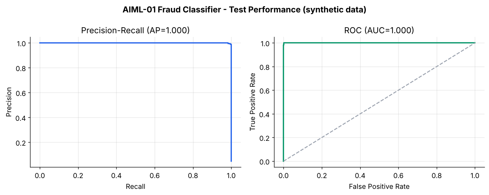
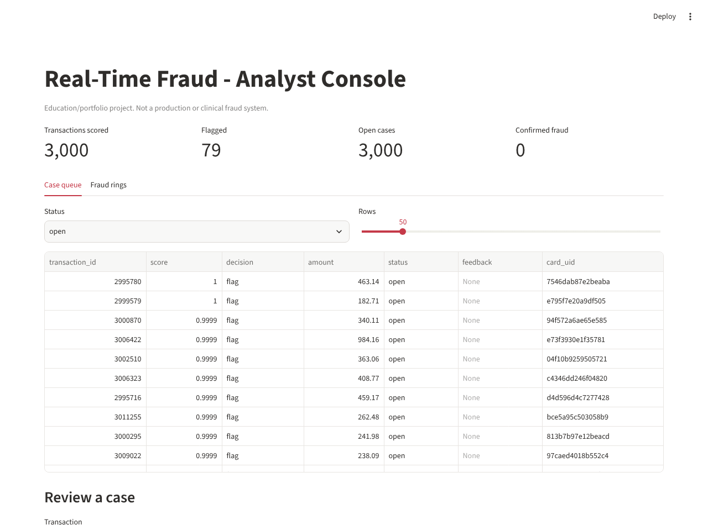

# Real-Time Financial Fraud Detection Platform

**Nexvia Technologies AI/ML Internship - Project AIML-01**

An end-to-end fraud platform that ingests a stream of transactions, scores each
one for fraud risk in milliseconds, links suspicious accounts into fraud rings
with a graph neural network, and gives analysts a dashboard to review cases.

> **Education / portfolio project. Not a production or regulated fraud system.**
> Scores are model estimates, not financial determinations.

---

## What it does

| Capability | How |
|---|---|
| Score each transaction in ms | FastAPI service + online feature store, p50 ≈ 2 ms |
| Handle <1% fraud | PR-AUC (not accuracy), class weighting / SMOTE, PR-curve threshold tuning |
| Detect fraud **rings** | Graph of shared card/device links + GraphSAGE GNN (PyTorch Geometric) |
| Blend signals | Weighted fusion of XGBoost + GNN scores |
| Train/serve parity | One feature definition shared via Feast |
| Catch model decay | Evidently drift report + automatic retraining trigger |
| Review queue | Streamlit analyst console with case status + feedback labels |
| Reproducibility | MLflow run tracking |
| Deploy | Docker Compose (local) and Kubernetes/Minikube manifests |

## Required stack → where it lives

| Technology | Location |
|---|---|
| **XGBoost** | `src/models/train_xgboost.py` |
| **PyTorch Geometric** (GNN) | `src/models/train_gnn.py`, `src/models/graph_builder.py` |
| **Feast** (feature store) | `feature_repo/`, `scripts/export_feast_source.py` |
| **MLflow** (tracking) | `src/common/tracking.py` |
| **Kafka** (streaming) | `src/streaming/producer.py`, `consumer.py` |
| **FastAPI** (serving) | `src/serving/app.py`, `scorer.py` |
| **Evidently AI** (drift) | `src/monitoring/drift.py` |
| **Kubernetes** | `deploy/k8s/` |

---

## Quickstart

The pipeline runs on generated synthetic data, so it works with no dataset
download and no GPU.

```bash
pip install -r requirements.txt

# 1. generate synthetic data + train XGBoost (writes artifacts/, metrics.json)
python -m src.models.train_xgboost --synthetic

# 2. cache graph features for the online path
python scripts/export_ring_cache.py

# 3. replay transactions through the scorer (no Kafka needed) -> fills case store
python scripts/replay_demo.py --limit 5000

# 4. open the analyst dashboard
streamlit run dashboard/app.py
```

Run the scoring API on its own:
```bash
uvicorn src.serving.app:app --port 8000
curl -X POST localhost:8000/score -H 'Content-Type: application/json' \
  -d '{"TransactionID":1,"TransactionDT":500000,"TransactionAmt":2500,"card4":"visa","DeviceInfo":"new-device#1","P_emaildomain":"gmail.com"}'
```

## Running on the IEEE-CIS dataset

1. Download **IEEE-CIS Fraud Detection** from Kaggle (see `data/README.md`).
2. Put `train_transaction.csv` (and `train_identity.csv`) in `data/`.
3. Train - the real files are used automatically:
   ```bash
   python -m src.models.train_xgboost     # no --synthetic flag
   ```
4. Train the GNN on a GPU (`notebooks/gnn_colab.ipynb`), then fuse the scores:
   ```bash
   python -m src.models.blend
   ```

## Full streaming + MLOps stack

```bash
docker compose up -d                               # Kafka, MLflow, API, dashboard
python -m src.streaming.producer --rate 50         # replay as a live stream
python -m src.streaming.consumer --from-beginning  # score the stream
python -m src.monitoring.drift                     # drift report + retrain trigger
```
Feature store:
```bash
python scripts/export_feast_source.py
cd feature_repo && feast apply && feast materialize-incremental $(date -u +%Y-%m-%dT%H:%M:%S)
```

---

## Results

The repository runs end to end on **synthetically generated transactions**, so
the full pipeline can be exercised without a dataset download. Synthetic fraud is
separable by construction, so those figures (and the screenshots below) are an
illustration of the working pipeline rather than benchmark numbers. The training,
evaluation and threshold-tuning code targets the IEEE-CIS dataset and writes
precision-recall AUC, ROC-AUC and the tuned threshold to `artifacts/metrics.json`
when run against it.

## Screenshots

From the synthetic-data run (see [`screenshots/`](screenshots/)):

| | |
|---|---|
| Test PR / ROC curves | `screenshots/01_pr_roc_curves.png` |
| Confusion matrix | `screenshots/02_confusion_matrix.png` |
| Top feature importances | `screenshots/03_feature_importance.png` |
| Fraud-ring graph (shared card/device links) | `screenshots/04_fraud_ring_graph.png` |
| FastAPI scoring service (`/docs`) | `screenshots/05_fastapi_docs.png` |
| Streamlit analyst dashboard | `screenshots/06_analyst_dashboard.png` |




## Where each component runs

The XGBoost model, feature engineering, graph construction, FastAPI scoring
service, Streamlit dashboard, SQLite case store and the pytest suite run on CPU.
The GraphSAGE GNN (PyTorch Geometric) trains on a GPU via `notebooks/gnn_colab.ipynb`.
Kafka, Feast, Evidently and the Kubernetes manifests run with their respective
services (Docker Compose brings up a local stack).

## Project structure

```
AIML-01/
├── src/
│   ├── common/      config, synthetic data, loader, MLflow helper
│   ├── features/    leak-free feature engineering
│   ├── models/      xgboost, graph builder, GNN, blend
│   ├── streaming/   kafka producer + consumer
│   ├── serving/     FastAPI app, scorer, online features, case store
│   └── monitoring/  evidently drift + retrain trigger
├── feature_repo/    Feast feature store
├── dashboard/       Streamlit analyst console
├── deploy/k8s/      Kubernetes manifests
├── notebooks/       EDA + GNN training
├── scripts/         demo replay, cache + feast exporters
├── tests/           pytest suite
├── screenshots/     pipeline + UI screenshots
└── docs/            architecture, model card, API reference
```

See `docs/` for the architecture diagram, model card (limits & bias), and API
documentation.
