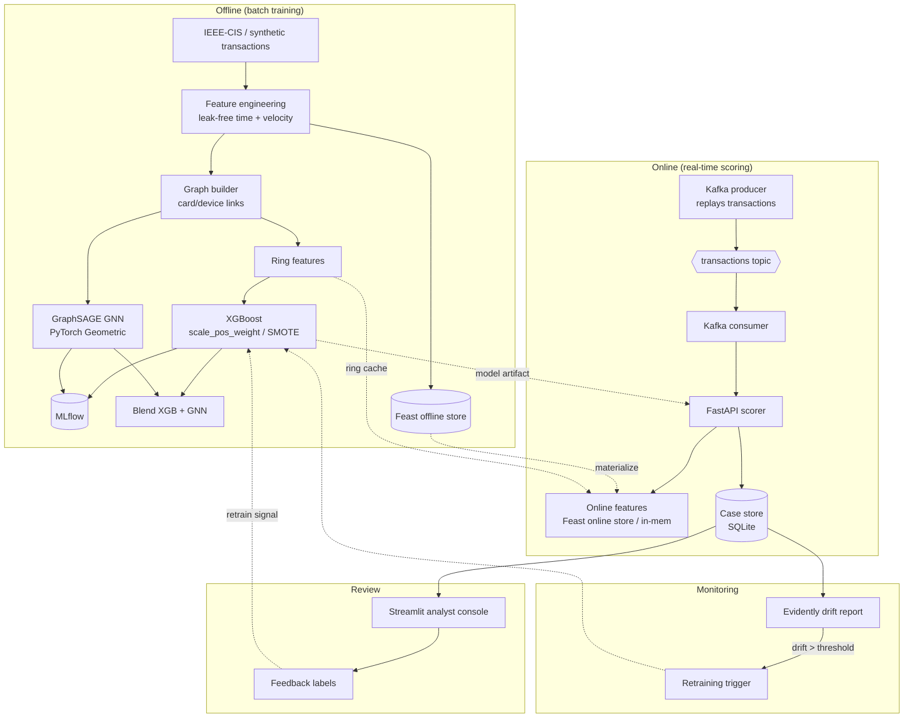

# Architecture

## Data + training flow

## Key design decisions

**Fraud-ring graph.** Transactions are nodes; edges connect transactions that
share a *specific* card (`card_uid`) or *specific* device fingerprint
(`device_uid`). Email *domain* is deliberately not an edge key — it is
low-cardinality and would merge unrelated people into one giant component.
Within each identity group, transactions are chained in time order to keep the
graph O(n) instead of O(n²) while preserving connected components exactly.

**Why GraphSAGE.** A transaction inside a dense shared-infrastructure cluster
(a ring) should be pushed toward fraud even if its own features look ordinary.
GraphSAGE aggregates neighbourhood information to do exactly that. It produces a
per-transaction score that is fused with XGBoost.

**Leak-free features.** Every rolling statistic (velocity, amount-vs-average,
recency, prior ring fraud rate) uses only transactions strictly *before* the one
being scored, via shifted cumulative sums and per-card time-window
`searchsorted`. A unit test asserts that a card's first transaction carries
no-history defaults.

**Online vs batch features.** Batch training computes history over the full
dataset. At serving time the same features come from rolling per-card state
(an in-memory store here; Feast online store backed by Redis in production).
Graph features are precomputed per card and looked up by the scorer — real-time
GNN inference on a live graph is a known hard problem, so ring scoring is batch
and the online model consumes cached ring features.

**Imbalance.** Fraud is <1% of transactions, so the model is trained with
`scale_pos_weight` (or SMOTE), evaluated with precision-recall AUC rather than
accuracy, and the decision threshold is tuned on the validation PR curve.
