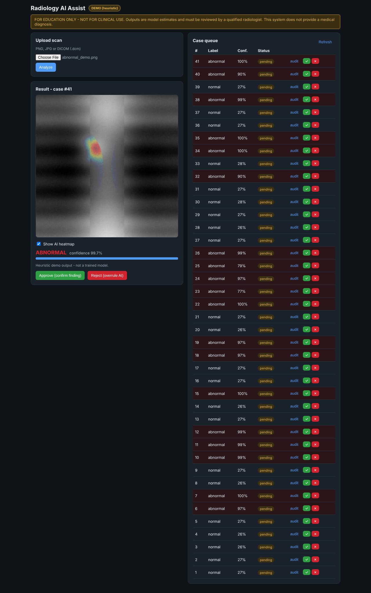
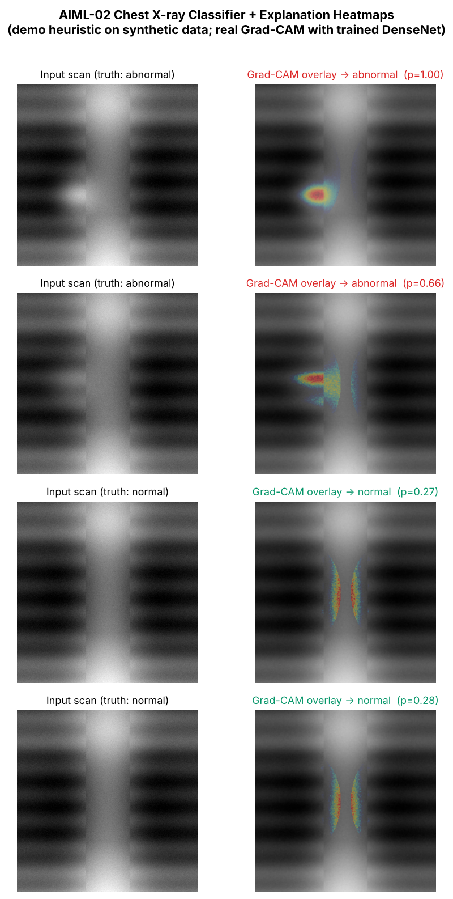

# AI-Assisted Medical Imaging & Diagnosis System

**Nexvia Technologies AI/ML Internship - Project AIML-02**

A platform where chest X-ray scans (PNG/JPG/DICOM) are uploaded, analysed by a
deep-learning model, shown with Grad-CAM explanation heatmaps, and reviewed by a
radiologist who approves or rejects each AI finding - with every decision logged
to an audit trail.

> ## FOR EDUCATION ONLY - NOT FOR CLINICAL USE
> Outputs are model estimates, not a medical diagnosis. Every result requires
> review by a qualified radiologist. Do not use on real patients or real
> clinical decisions. See `docs/model_card.md` for limits and bias.

---

## What it does

| Capability | How |
|---|---|
| Upload scans | PNG/JPG **and DICOM**, parsed with pydicom |
| Classify | DenseNet121 transfer learning (normal vs abnormal) |
| Explain | **Grad-CAM** heatmaps showing which region drove the prediction |
| Segment | MONAI **3D U-Net** on Medical Segmentation Decathlon |
| Radiologist review | React viewer: overlay toggle, confidence, Approve/Reject |
| Audit | Every decision written to an immutable audit log |
| Ingest from PACS | **Orthanc** DICOM server + pull/infer/store worker |
| Reproducibility | **DVC** data+model versioning, MLflow tracking |
| Deploy | **Docker** Compose (backend + Orthanc + viewer) |

## Required stack → where it lives

| Technology | Location |
|---|---|
| **MONAI** (3D U-Net) | `src/models/segmentation.py`, `src/training/train_segmentation.py` |
| **PyTorch** | classifier + segmentation + Grad-CAM |
| **Grad-CAM** | `src/models/gradcam.py` |
| **Orthanc DICOM server** | `src/orthanc/` + `docker-compose.yml` |
| **DVC** | `dvc.yaml`, `.dvcignore` |
| **Docker** | `Dockerfile`, `viewer/Dockerfile`, `docker-compose.yml` |
| **React** | `viewer/` (Vite) |

---

## Quickstart

The app runs on generated synthetic chest X-rays, so the full flow - upload →
heatmap → review → audit - works with no dataset download and no GPU.

```bash
pip install -r requirements.txt

# 1. generate synthetic scans (+ a few DICOM studies) and seed demo cases
python scripts/generate_synthetic.py --n 400 --as-dicom 20
python scripts/demo_seed.py --limit 40

# 2. start the backend
uvicorn src.serving.app:app --port 8000

# 3. start the React viewer
cd viewer && npm install && npm run dev      # http://localhost:5173
```

Try the API directly:
```bash
curl -F "file=@data/images/xray_00000.png" localhost:8000/analyze
```

## Training the classifier on a real dataset

The DenseNet classifier, Grad-CAM and the 3D U-Net use torch/torchvision/MONAI
and train on a GPU.

1. Download a real dataset (RSNA Pneumonia or NIH ChestX-ray14 - see
   `data/README.md`) and build `data/labels.csv`.
2. `notebooks/train_classifier_colab.ipynb` trains DenseNet121 and saves
   `artifacts/densenet_chestxray.pt`. The backend then serves the trained model
   and real Grad-CAM, and the UI badge changes from `DEMO` to `LIVE MODEL`.
3. `notebooks/train_segmentation_colab.ipynb` trains the MONAI 3D U-Net on the
   Medical Segmentation Decathlon.

## Full stack with Orthanc (Docker)

```bash
docker compose up -d --build        # orthanc + backend + worker + viewer
python scripts/generate_synthetic.py --as-dicom 20
python scripts/push_to_orthanc.py   # push DICOM studies into Orthanc
# the worker pulls new studies, scores them, and they appear in the viewer
```

---

## Results

The repository runs end to end on **synthetically generated chest X-rays** with a
deterministic fallback predictor (badged `DEMO` in the UI), so the full flow works
without a dataset download. Synthetic data is separable by construction, so those
figures (and the screenshots below) illustrate the working system rather than
benchmark numbers. Training DenseNet121 on a real dataset via
`notebooks/train_classifier_colab.ipynb` writes ROC-AUC, sensitivity and
specificity to `artifacts/metrics.json` and serves the trained model.

## Screenshots

From the synthetic-data demo (see [`screenshots/`](screenshots/)):

| | |
|---|---|
| Classifier + explanation heatmaps | `screenshots/01_gradcam_overlays.png` |
| React radiologist viewer (home) | `screenshots/02_viewer_home.png` |
| Viewer: analysed scan, heatmap, Approve/Reject, case queue | `screenshots/03_viewer_result.png` |
| FastAPI backend (`/docs`) | `screenshots/04_fastapi_docs.png` |




## Where each component runs

The DICOM/image handling, preprocessing, FastAPI backend, SQLite case store +
audit log, overlay rendering and the pytest suite run on CPU; the React viewer
builds with Vite. The DenseNet classifier with Grad-CAM and the MONAI 3D U-Net
train on a GPU via the notebooks. The Orthanc worker runs against a running
Orthanc server (Docker Compose brings up the full stack).

## Project structure

```
AIML-02/
├── src/
│   ├── common/      config, synthetic X-rays, DICOM I/O, preprocessing
│   ├── models/      densenet classifier, grad-cam, 3D U-Net, fallback, predictor
│   ├── training/    train_classifier, train_segmentation
│   ├── serving/     FastAPI app, inference, case store + audit, overlay
│   └── orthanc/     DICOM server config + pull/infer/store worker
├── viewer/          React (Vite) radiologist viewer
├── scripts/         data generation, demo seed, Orthanc push
├── notebooks/       EDA + training (classifier, segmentation)
├── tests/           pytest suite
├── screenshots/     pipeline + UI screenshots
├── docs/            architecture, model card, API reference
├── dvc.yaml         DVC data/model pipeline
└── docker-compose.yml
```

See `docs/` for the architecture diagram, model card (limits & bias), and API
reference.
