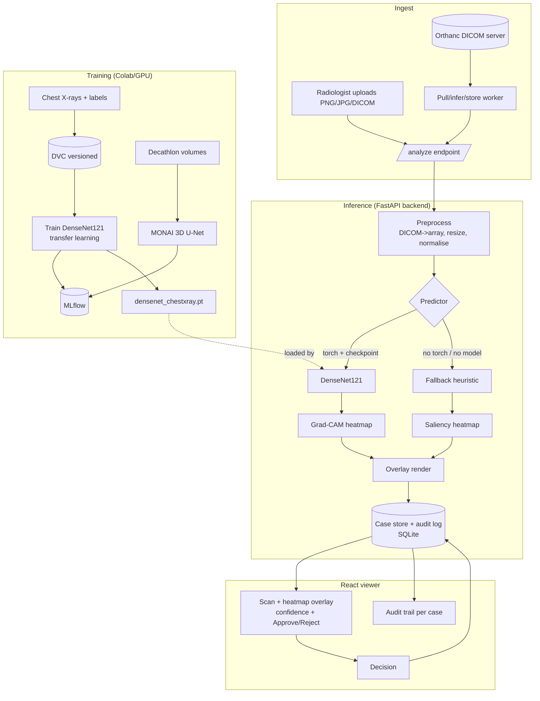

# Architecture

## Key design decisions

**Two-tier predictor.** The backend uses the real DenseNet + Grad-CAM when torch
and a trained checkpoint are present, and a deterministic image-processing
fallback otherwise. This keeps the whole app runnable (demo, CI, first-run)
without a GPU, and the UI badges the mode (`LIVE MODEL` vs `DEMO`). The fallback
is a transparent opacity detector, never presented as a neural network.

**Grad-CAM for trust.** A diagnosis-assist tool must show *why*. Grad-CAM
weights the last conv block's feature maps by the gradient of the predicted
class, producing a heatmap of the pixels that drove the call. The synthetic
generator plants a known opacity, so the heatmap can be checked against ground
truth - a built-in sanity test (see `tests/test_fallback_heatmap_localizes`).

**Human-in-the-loop by construction.** The model never decides. Each scan
becomes a *pending* case; a radiologist approves or rejects; every action writes
an immutable audit row. This is both an ethical requirement and the brief's
"Approve/Reject + audit log" deliverable.

**Classification first, segmentation as extension.** 2D chest X-ray
classification + Grad-CAM is the fully-built, demonstrable core. The MONAI 3D
U-Net (volumetric segmentation on the Decathlon) is a separate, heavier model that trains on a GPU (e.g. Colab) with the
Decathlon dataset.

**DICOM throughout.** Uploads and the Orthanc path both go through pydicom, with
Photometric Interpretation and Rescale slope/intercept honoured, so the pipeline
handles real DICOM, not just PNGs.
